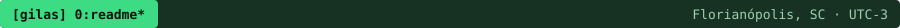

<p align="center"></p>


```text
name      Guilherme Anselmo (gilas-byte)
base      Florianópolis, SC, Brazil
age       20
studying  Data Science & AI, UniSENAI, 4th semester, class of 2028
aiming    data, cybersecurity, development
workflow  small steps, visible progress
```


```text
data   Python  SQL  Pandas  NumPy  scikit-learn  Jupyter  PostgreSQL  SQLite
build  FastAPI  Streamlit  JavaScript  HTML  Tailwind  Supabase
tools  Docker  Git  Arch Linux  VS Code
```


| Project | Language | What it is |
|---|---|---|
| **[PC Builder](https://github.com/gilas-byte/pc-builder)** | `Python` | Local dashboard that tracks PC part prices from Brazilian stores and public Telegram deal channels. |
| **[Datathon Kirasapiens](https://github.com/gilas-byte/datathon-kirasapiens)** | `Jupyter` | Team project for Datathon CDIA 2026, with a published dashboard. |
| **[Radar ENEM](https://github.com/gilas-byte/projetoAplicado3)** | `Python` | Streamlit dashboard for exploring ENEM data. Group project. |
| **[DopaNotes](https://github.com/gilas-byte/DopaNotes)** | `JavaScript` | Tasks, habits and notes for easily distracted brains. FastAPI, PostgreSQL, Docker. |
| **[DRG-Stats-Tracker](https://github.com/gilas-byte/DRG-Stats-Tracker)** | `Python` | Parses a Deep Rock Galactic save file into SQLite and a Streamlit dashboard. |
| **[youtube-transcriber](https://github.com/gilas-byte/youtube-transcriber)** | `Python` | YouTube transcription tool. |
| **[Papi-Mine-Servers](https://github.com/gilas-byte/Papi-Mine-Servers)** | `Python` | Real-time Minecraft server monitor with a retro terminal look. |
| **[my-version-termo](https://github.com/gilas-byte/my-version-termo)** | `Python` | Quick Python project, just messing around. |
| **[macOS-Arch-theme](https://github.com/gilas-byte/macOS-Arch-theme)** | `Python` | macOS Tahoe dark theme for Arch and CachyOS with KDE Plasma 6. |
| **[OlMaganize-OS-Theme](https://github.com/gilas-byte/OlMaganize-OS-Theme)** | `Python` | Desktop theme. |


<!-- Cards regenerated by .github/workflows/stats.yml; served from this repository. -->
<p align="center">
  
  
</p>

<!-- Snake regenerated by .github/workflows/snake.yml into the output branch. -->
<p align="center">
  
</p>


[LinkedIn](https://www.linkedin.com/in/guilherme-da-silva-anselmo) · [Email](mailto:guilherme.silva.anselmo@gmail.com) · [Discord](https://discord.com/users/gilasx) · [YouTube](https://www.youtube.com/@Intervorder)


