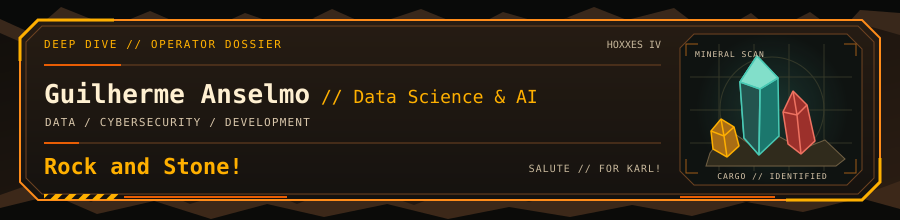
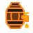

<p align="center">
  
</p>

<p align="center">
  <strong><code>MISSION CONTROL // DEEP DIVE BRIEFING</code></strong><br />
  <sub>HOXXES IV · DATA / CYBERSECURITY / DEVELOPMENT</sub>
</p>

<p align="center">
  <a href="https://www.linkedin.com/in/guilherme-da-silva-anselmo"></a>
  <a href="mailto:guilherme.silva.anselmo@gmail.com"></a>
  <a href="https://discord.com/users/gilasx"></a>
  <a href="https://www.youtube.com/@Intervorder"></a>
</p>

> **MISSION CONTROL:** Listen up, miner. The data is messy, the bugs have armor, and Management still wants a dashboard.

*Elevator ride: briefing loading. Mission Control says the wait is not billable.*

---

##  `01 // MISSION`

**Primary objective:** graduate in **Data Science & AI at UniSENAI (2028)**.

**Secondary objectives:** land a role in **data or cybersecurity**, and ship side quests along the way. Management gets the report.

```text
OPERATOR    Guilherme Anselmo / gilas-byte
BASE        Florianópolis, SC, Brazil
AGE         20
TRAINING    4th semester · Data Science & AI
WORKFLOW    ADHD-friendly: small objectives, visible progress
SIDE QUEST  Reverse-engineer a DRG binary save format. For fun.
```

One objective at a time. Even when the cave has seventeen interesting tunnels.

**Hazard modifier:** scope creep. Bosco has been told not to encourage it.

##  `02 // LOADOUT`

**Primary · data extraction & analysis**

<p>
  
  
  
  
  
  
  
  
</p>

**Secondary · APIs & interfaces**

<p>
  
  
  
  
  
  
</p>

**Utility · deployment & field tools**

<p>
  
  
  
  
</p>

*Resupply policy: refill the tools before blaming the cave. Nitra is not a package manager.*

##  `03 // OBJECTIVE BOARD`

###  `DOING // boots on the ground`

| Assignment | Briefing |
|:--|:--|
|  **[PC Builder](https://github.com/gilas-byte/pc-builder)** | Local dashboard tracking PC component prices. Mining for a decent deal. The M.U.L.E. refuses surge pricing. |
|  **Mnemo** · private | In development. Still inside the drop pod. Bosco is indexing the luggage. |
|  **[Datathon Kirasapiens](https://github.com/gilas-byte/datathon-kirasapiens)** | Team project for Datathon CDIA 2026. Hazard 4: the swarm brought a CSV. |

###  `PARKED // left it in the cave`

No shame in marking the tunnel and coming back with more ammo.

| Assignment | Recovery note |
|:--|:--|
|  **[Papi-Mine-Servers](https://github.com/gilas-byte/Papi-Mine-Servers)** | Minecraft server monitor. Different mine, same habit. Mission Control still wants uptime. |
|  **[my-version-termo](https://github.com/gilas-byte/my-version-termo)** | Parked. Extraction date: eventually. Five letters. Somehow a Deep Dive. |
|  **bar-do-papaio** · private | Left it in the cave. Please don't drink the evidence. Leaf-lovers get read-only access. |

###  `SHIPPED // cargo secured`

| Delivery | Recovered cargo |
|:--|:--|
|  **[DRG-Stats-Tracker](https://github.com/gilas-byte/DRG-Stats-Tracker)** | Binary save parsing, kill counts and progression snapshots. The bugs became rows in SQLite. For Karl, and for referential integrity. |
|  **[DopaNotes](https://github.com/gilas-byte/DopaNotes)** | Tasks, habits and notes, backed by a REST API. For brains with too many side quests. The M.U.L.E. carries the backlog. |
|  **[projetoAplicado3 · Radar ENEM](https://github.com/gilas-byte/projetoAplicado3)** | Streamlit dashboard for exploring ENEM data. Morkite is easier to find than a clean CSV. |
|  **[youtube-transcriber](https://github.com/gilas-byte/youtube-transcriber)** | YouTube transcription tool. Recovered the words; skipped the replay. Mission Control finally gets subtitles. |
|  **[macOS-Arch-theme](https://github.com/gilas-byte/macOS-Arch-theme)** · **[OlMaganize-OS-Theme](https://github.com/gilas-byte/OlMaganize-OS-Theme)** | Desktop themes. Even the space rig deserves a decent interface. Management declined the decoration budget. |
|  **[Datathon pages](https://gilas-byte.github.io/datathon-kirasapiens/)** | Published site for the datathon project. Cargo delivered; the mission above is still active. Drop pod returned; paperwork did not. |

##  `04 // FIELD REPORT`

Telemetry from the space rig. Private expeditions don't all show up on the scanner.

*Mission Control says green numbers are good. It has not inspected the cave.*

<!-- Cards regenerated by .github/workflows/stats.yml; served from this repository. -->
<p align="center">
  
  
</p>

<p align="center">
  <picture>
    <source media="(prefers-color-scheme: dark)" srcset="https://raw.githubusercontent.com/gilas-byte/gilas-byte/output/github-contribution-grid-snake-dark.svg" />
    <source media="(prefers-color-scheme: light)" srcset="https://raw.githubusercontent.com/gilas-byte/gilas-byte/output/github-contribution-grid-snake.svg" />
    
  </picture>
</p>

---

<p align="center">
   <strong><code>ROCK AND STONE!</code></strong><br />
  <sub><code>rock and stone, or you ain't comin' home</code></sub>
  <br /><sub>Did I hear a Rock and Stone? Salute! For Karl!</sub>
</p>
